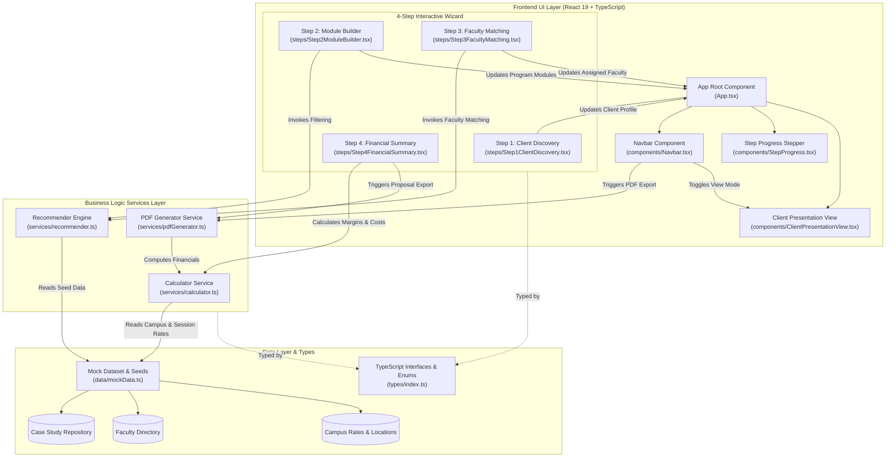

# Custom Program Scope Builder — IESE Business School Executive Education

[](https://www.iese.edu)
[](https://react.dev)
[](https://www.typescriptlang.org)
[](https://vitejs.dev)
[](https://tailwindcss.com)

A web application built for **IESE Business School Executive Education**. The **Custom Program Scope Builder** (*Herramienta Interna DDC*) empowers Directors of Corporate Development (*Directores de Desarrollo de Corporativos - DDC*) to rapidly scope, architect, price, and present custom executive education proposals for corporate enterprise clients.

---

## 📋 Table of Contents

- [Executive Overview](#1-executive-overview)
- [Architecture Diagram](#2-architecture-diagram)
- [System Components & Modules Breakdown](#3-system-components--modules-breakdown)
  - [Frontend UI Components](#frontend-ui-components)
  - [Business Logic Services](#business-logic-services)
  - [Data Layer & Type Definitions](#data-layer--type-definitions)
- [Port Configuration](#4-port-configuration)
- [Environment Setup & Installation](#5-environment-setup--installation)
- [Available Scripts & Commands](#6-available-scripts--commands)

---

## 1. Executive Overview

The **Custom Program Scope Builder** addresses the complex, multi-variable process of designing bespoke executive education programs for global enterprise clients (e.g., Banco Santander, Telefónica, Novartis, Repsol). 

### Key Purpose & Business Objectives
- **Rapid Proposal Scoping**: Streamlines proposal creation from traditional multi-day workflows down to interactive, real-time sessions during or immediately after client discovery meetings.
- **Academic & Pedagogical Matching**: Automatically recommends relevant IESE Case Studies and pairs high-profile Faculty Members based on the client's industry sector, target audience seniority, and strategic learning objectives (e.g., *Digital Transformation*, *ESG & Sustainability*, *AI & Business Analytics*).
- **Financial Compliance & Real-Time Margin Safeguards**: Dynamically calculates direct costs (Faculty honorarios, Case study copyright licensing, Campus catering & facilities, LMS platform support) and enforces target gross margin benchmarks ($\ge 55\%$) with visual safety alerts (`healthy`, `warning`, `critical`).
- **Dual-Mode Experience (Internal vs. Client Presentation)**: Features a one-click **Client Presentation Mode** (*Modo Cliente*) that suppresses sensitive internal cost structures and gross margins when projecting proposals live in executive boardrooms or client meetings.
- **Export & CRM Integration**: Supports multi-currency budgeting (EUR $\text{€}$ and USD $\$$) with automatic conversion rates, CRM draft saving triggers, and client-ready PDF proposal document generation styled with official IESE branding (`#9E002C` IESE Red).

---

## 2. Architecture Diagram

The application is structured into three clean layers: **Frontend UI**, **Business Logic Services**, and **Data Layer & Schemas**.



---

## 3. System Components & Modules Breakdown

### Frontend UI Components

| Component | File Path | Description / Role |
| :--- | :--- | :--- |
| **`App`** | [`src/App.tsx`](file:///Users/estherarribas/iese-demo/src/App.tsx) | Core application orchestrator managing global state (`clientProfile`, `modules`, `discountPercentage`, `currency`, `isClientView`, `activeStep`, `crmSaved`, `proposalCode`), step navigation, and view mode switching. |
| **`Navbar`** | [`src/components/Navbar.tsx`](file:///Users/estherarribas/iese-demo/src/components/Navbar.tsx) | Sticky top navigation bar featuring IESE branding, client & proposal metadata, currency switcher ($\text{EUR}/\text{USD}$), Client Mode toggle, CRM Save Draft trigger with confetti confirmation, and PDF Export button. |
| **`StepProgress`** | [`src/components/StepProgress.tsx`](file:///Users/estherarribas/iese-demo/src/components/StepProgress.tsx) | Interactive 4-step wizard navigation stepper displaying progress indicators, completion states, and step labels. |
| **`Step1ClientDiscovery`** | [`src/components/steps/Step1ClientDiscovery.tsx`](file:///Users/estherarribas/iese-demo/src/components/steps/Step1ClientDiscovery.tsx) | Intake discovery step for defining client details (company name, industry sector, cohort size, target audience seniority, delivery format, primary campus, and strategic objectives). |
| **`Step2ModuleBuilder`** | [`src/components/steps/Step2ModuleBuilder.tsx`](file:///Users/estherarribas/iese-demo/src/components/steps/Step2ModuleBuilder.tsx) | Modular architecture builder allowing DDCs to configure program modules, set duration in days, select campus locations, add/edit teaching sessions, and auto-recommend or assign case studies from IESE's library. |
| **`Step3FacultyMatching`** | [`src/components/steps/Step3FacultyMatching.tsx`](file:///Users/estherarribas/iese-demo/src/components/steps/Step3FacultyMatching.tsx) | Academic matching component providing automated recommendations and manual assignment of IESE professors based on sector expertise, language requirements ($\text{ES}$, $\text{EN}$, $\text{PT}$), and real-time availability status (`available`, `pending_ad`, `unavailable`). |
| **`Step4FinancialSummary`** | [`src/components/steps/Step4FinancialSummary.tsx`](file:///Users/estherarribas/iese-demo/src/components/steps/Step4FinancialSummary.tsx) | Commercial & financial dashboard providing line-item direct cost breakdowns, target margin indicators, interactive discount controls, gross margin compliance warnings, and proposal finalization tools. |
| **`ClientPresentationView`** | [`src/components/ClientPresentationView.tsx`](file:///Users/estherarribas/iese-demo/src/components/ClientPresentationView.tsx) | High-executive presentation mode specifically tailored for live pitch meetings with corporate clients. Hides internal costs and profit margins while highlighting program architecture, faculty bios, case studies, and total investment summary. |

---

### Business Logic Services

| Service | File Path | Role & Calculation Logic |
| :--- | :--- | :--- |
| **Calculator Service** | [`src/services/calculator.ts`](file:///Users/estherarribas/iese-demo/src/services/calculator.ts) | Implements IESE's commercial pricing model:<br/>• **Faculty Honorarios**: $\text{Sessions} \times €2,800$<br/>• **Case Licensing**: $\text{Cases} \times \text{Cohort Size} \times €45$<br/>• **Campus Facilities & Catering**: $\text{Days} \times \text{Cohort Size} \times \text{Daily Rate}$ (€180/day for Barcelona/Madrid, €240/day for NY/Munich, €75/day for In-Company)<br/>• **LMS Support**: $€3,500 + (\text{Cohort Size} \times €50)$<br/>• **Pricing & Margin Strategy**: Target Gross Margin $= 55\%$. Base Price $= \text{Direct Costs} / (1 - 0.55)$. Margin health thresholds: `healthy` ($\ge 50\%$), `warning` ($45\% - 49.9\%$), `critical` ($< 45\%$).<br/>• **Currency Conversion**: Converts EUR to USD at exchange rate ($1.08$). |
| **Recommender Engine** | [`src/services/recommender.ts`](file:///Users/estherarribas/iese-demo/src/services/recommender.ts) | Algorithmic matching engine filtering:<br/>• `recommendCases`: Matches case studies against the client's sector and selected strategic objectives.<br/>• `recommendFaculty`: Matches faculty members by primary industry experience and department specialization. |
| **PDF Generator** | [`src/services/pdfGenerator.ts`](file:///Users/estherarribas/iese-demo/src/services/pdfGenerator.ts) | Client-side proposal document export engine using `jspdf`. Renders branded PDF documents with official IESE crimson header (`#9E002C`), reference codes, client profile summary, modular architecture breakdown, and estimated commercial budget. |

---

### Data Layer & Type Definitions

| Module | File Path | Purpose |
| :--- | :--- | :--- |
| **Mock Dataset** | [`src/data/mockData.ts`](file:///Users/estherarribas/iese-demo/src/data/mockData.ts) | Contains pre-populated seed data for IESE case studies, faculty directory, campus options, default program modules, strategic learning objectives, and industry sectors. |
| **Type Definitions** | [`src/types/index.ts`](file:///Users/estherarribas/iese-demo/src/types/index.ts) | Central TypeScript definitions including `ClientProfile`, `ProgramModule`, `ProgramSession`, `CaseStudy`, `FacultyMember`, `CostBreakdown`, `FinancialMetrics`, `ProposalState`, and union types for currencies, sectors, target levels, and campus locations. |

---

## 4. Port Configuration

The application is bundled and served using **Vite**.

- **Default Development Port**: `5173`
- **Fallback Port**: `5174` (automatically used if port `5173` is occupied)
- **Local Dev URL**: `http://localhost:5173/`

Port configuration is defined in [`vite.config.ts`](file:///Users/estherarribas/iese-demo/vite.config.ts):

```typescript
import { defineConfig } from 'vite';
import react from '@vitejs/plugin-react';
import tailwindcss from '@tailwindcss/vite';

export default defineConfig({
  plugins: [react(), tailwindcss()],
  server: {
    port: 5173,
    strictPort: false
  }
});
```

---

## 5. Environment Setup & Installation

### Prerequisites
- **Node.js**: `v18.0.0` or higher (v20+ recommended)
- **npm**: `v9.0.0` or higher

### Installation Steps

1. **Clone or navigate to the project directory**:
   ```bash
   cd /Users/estherarribas/iese-demo
   ```

2. **Install dependencies**:
   ```bash
   npm install
   ```

---

## 6. Available Scripts & Commands

In the project directory, you can run the following scripts:

| Command | Action |
| :--- | :--- |
| `npm run dev` | Starts the Vite development server on `http://localhost:5173/` with Hot Module Replacement (HMR). |
| `npm run build` | Runs TypeScript compilation (`tsc -b`) and builds the optimized production bundle into the `dist/` directory. |
| `npm run preview` | Boots a local static web server to preview the production build in `dist/`. |
| `npm run lint` | Runs `oxlint` for high-performance JavaScript/TypeScript and React code analysis. |
| `npm test` | Runs the test suite (via Vitest/Jest runner if configured) or validates TypeScript & linter checks (`npx tsc -b && npm run lint`). |

### Running the Development Server
```bash
npm run dev
```

### Type Checking & Linting
```bash
npx tsc -b
npm run lint
```

---

*IESE Business School — Executive Education • Custom Programs Division (DDC)*
